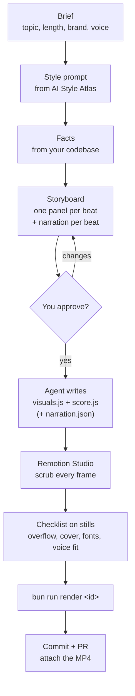
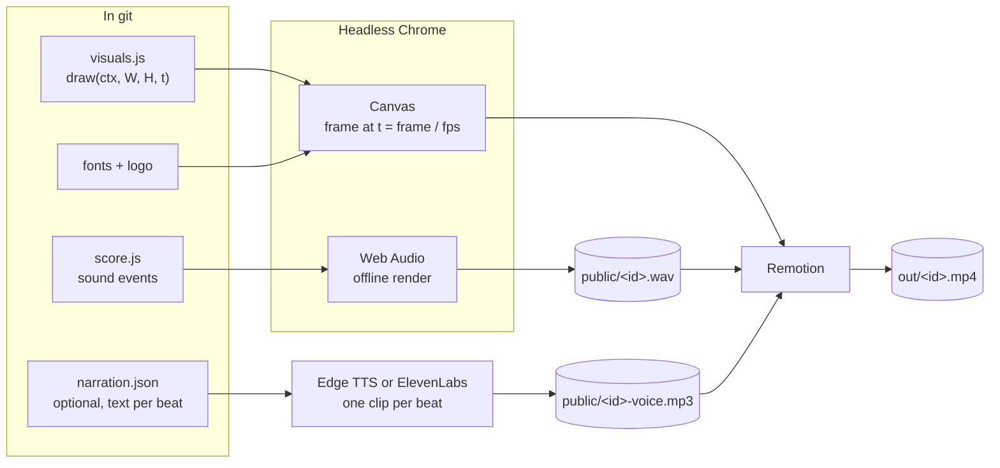

# code-motion

[English](README.md) | [ไทย](README.th.md)

[](LICENSE)

An agent skill for making product videos as code: canvas visuals and Web Audio sound, rendered to
MP4 with [Remotion](https://www.remotion.dev), in a style picked from
[Futurepedia AI Style Atlas](https://www.futurepedia.io/resources/ai-style-atlas/view).

https://github.com/user-attachments/assets/bc4688bd-7462-4f4b-93bf-dfa9f48d5dde

No video editor: every frame is a pure function of time, all sound is synthesized, and the video
lives in git, so you can review it in a PR and re-render it any time.

Works with any coding agent that can read files and run shell commands: Claude Code, Codex,
Cursor, OpenCode and others. The skill is plain Markdown plus Bun commands.

## How it works

### Workflow



### Render pipeline



Same code in, same video out: lose the MP4 and run `bun run render <id>` again.

### Voiceover (optional)

Narration is written per beat in `narration.json`, so each line starts with its scene and can't
drift. `bun run voiceover <id>` uses free Edge TTS neural voices, or ElevenLabs when
`ELEVENLABS_API_KEY` is set, and refuses to finish if a line runs into the next scene. Each
video can also set its own frame rate (30 by default, 60 for smoother motion). Ready-made prompts
are in [prompts/voiceover-video-prompts.md](prompts/voiceover-video-prompts.md).

## Install

**With the [skills CLI](https://github.com/vercel-labs/skills)** (Node.js 22.20+), from your
project:

```bash
npx skills add savepong/code-motion-skill
```

It asks which coding agents to install to (Claude Code, Codex, Cursor and many more). Add `-g` to
install it for all your projects.

**By hand:** copy the skill folder into your project. You only need `skills/code-motion/`.

**Claude Code**

```bash
git clone --depth 1 https://github.com/savepong/code-motion-skill /tmp/code-motion-skill
mkdir -p .claude/skills
cp -R /tmp/code-motion-skill/skills/code-motion .claude/skills/
```

Then use `/code-motion` or ask for a video. To have it in every project, copy it to
`~/.claude/skills/` instead.

**Codex, Cursor, OpenCode and others:** copy it to `.agents/skills/code-motion/` and add a line to
your `AGENTS.md`:

```md
To make or re-render a product video, read and follow `.agents/skills/code-motion/SKILL.md`.
```

## Use

```text
/code-motion 25-second intro trailer for our app, in Thai, using our real logo
```

Install the skill in your own project, then follow what the agent asks. That is the whole process:

1. Pick a style on the Style Atlas and save its prompt to `prompts/<style>.md` when asked.
2. Approve the storyboard (and the narration, if you asked for a voiceover).
3. Watch it in Remotion Studio (`bun run studio`, http://localhost:3000) and ask for changes.
4. The agent runs `bun run render <id>`. The MP4 is in `out/<id>.mp4`.

## What's in this repo

| Path                       | What                                                                      |
| -------------------------- | ------------------------------------------------------------------------- |
| `skills/code-motion/`      | The skill: `SKILL.md` (workflows, checklist) and `REFERENCE.md` (the Remotion shell, voiceover script) |
| `examples/tutorial/`       | The 34-second Thai tutorial video about this skill, made with this skill  |
| `prompts/claude-desktop-prompt.md` | Instructions to use the same workflow in Claude Desktop / Claude Projects |
| `prompts/voiceover-video-prompts.md` | Copy-paste prompts for narrated videos (storyboard, voice, duration, format, FPS) and which models fit |

### Example: the tutorial video

A Manga Page style tutorial, in 16:9 and 9:16, built by following the skill end to end. It shows
the whole shape of a real project: `visuals.js`, `score.js`, a vertical cut, self-hosted fonts,
the render scripts and the voiceover script. See [examples/tutorial/README.md](examples/tutorial/README.md) to render it.

## Requirements

Bun, and internet on the first render (Remotion downloads a headless Chrome). Tested with Remotion
4.0.530 and React 19.2.7.

For voiceover: `ffmpeg` and `ffprobe` on the PATH, and internet while generating it. ElevenLabs
needs `ELEVENLABS_API_KEY`; Edge TTS needs no key.

## Contributing

Issues and pull requests are welcome: bugs you hit while making a video, fixes to the shell,
new example videos, or better guidance in `SKILL.md`. If you add an example, leave out the style
prompt and the code that comes from it (see below) and explain how to get it.

## Third-party material

Styles come from [Futurepedia AI Style Atlas](https://www.futurepedia.io/resources/ai-style-atlas/view).
Their prompts, reference code, `H` helper library and `SOUND` kit belong to Futurepedia and are not
in this repo. Fonts in the example are under the SIL Open Font License; their licences sit next to
the font files.

## License

MIT for the code and docs in this repo. See [LICENSE](LICENSE).
